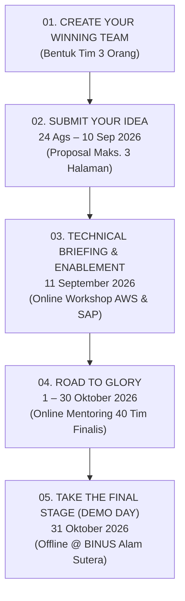

# AI Agentic Hackathon: Build the Future of Intelligent Innovation
### Official Competition Guidebook & Information

> **Penyelenggara**: SOKRATES (Host) bekerja sama dengan Universitas Bina Nusantara (BINUS) Alam Sutera  
> **Lokasi Final**: Kampus BINUS University Alam Sutera, Tangerang  
> **Periode**: 24 Agustus 2026 – 31 Oktober 2026  
> **Total Hadiah**: > IDR 130.000.000 (Terpisah per Kategori Track)  

---

## 1. Executive Summary & Tentang Program

**AI Agentic Hackathon** adalah program inovasi *hands-on* yang dirancang untuk memberdayakan generasi penerus developer, mahasiswa, dan teknolog di seluruh Indonesia guna mengubah ide menjadi solusi AI otonom dunia nyata (*real-world AI solutions*).

Bertempat di **Universitas Bina Nusantara (BINUS) Alam Sutera** dengan **SOKRATES** sebagai tuan rumah, hackathon ini mempertemukan komunitas universitas dari seluruh nusantara untuk mengeksplorasi kekuatan teknologi **AWS** dan **SAP Agentic AI** melalui tantangan praktis, kolaborasi lintas disiplin, dan inovasi akseleratif.

> [!NOTE]
> Lebih dari sekadar kompetisi, hackathon ini merupakan platform untuk **belajar (learn), membangun (build), berkolaborasi (collaborate), dan menciptakan dampak nyata (create impact)**. Peserta akan mendapatkan sesi *enablement hands-on*, keterampilan praktis AI terkini, serta eksposur langsung ke teknologi yang membentuk masa depan dunia kerja dan industri enterprise.

Perjalanan kompetisi dimulai dari seleksi proposal daring (*online submission*), dilanjutkan dengan sesi *enablement* & *mentoring* intensif dari pakar industri, dan berpuncak pada **Demo Day luring (offline)** di kampus BINUS Alam Sutera.

---

## 2. Kategori Track Kompetisi

Peserta akan berkompetisi dalam 2 pilihan track strategis:

| No | Track | Deskripsi & Fokus Solusi |
|:---:|:---|:---|
| **01** | 🚚 **Intelligence Supply Chain** | Bangun agen AI otonom (*AI agent*) yang memecahkan tantangan bisnis nyata pada proses rantai pasok (*Supply Chain processes*), seperti demand forecasting, logistik, pengadaan (*procurement*), inventory management, atau pelacakan distribusi. |
| **02** | 🏭 **Intelligence Manufacturing** | Bangun agen AI otonom (*AI agent*) yang menyelesaikan tantangan bisnis nyata pada proses manufaktur (*Manufacturing processes*), seperti otomatisasi inspeksi kualitas, *defect detection & resolution*, *predictive maintenance*, optimasi jadwal lini produksi, atau manajemen *shop-floor*. |

> [!TIP]
> Hadiah kompetisi diberikan **terpisah untuk masing-masing kategori track**. Pilihlah track yang memiliki relevansi masalah industri paling nyata dan ketersediaan data/skenario simulasi yang solid untuk MVP Anda.

---

## 3. Ketentuan Peserta (Who Can Join?)

Hackathon ini terbuka untuk seluruh komunitas akademik universitas di Indonesia.

- **Syarat Komunitas**: Terbuka untuk mahasiswa aktif (*university students*) dan staf akademik/dosen (*academic staff/lecturers*) di seluruh Indonesia.
- **Kombinasi Tim**: Mahasiswa dan staf akademik dapat berkolaborasi membentuk tim pemenang dan berkompetisi secara setara.
- **Komposisi Wajib (Team of 3)**:
  - Setiap tim wajib beranggotakan **tepat 3 (tiga) orang**.
  - Anggota tim dapat berupa:
    - 3 mahasiswa, atau
    - Kombinasi mahasiswa dan dosen/staf akademik, atau
    - 3 staf akademik.
  - **Syarat Utama**: Semua anggota tim wajib berasal dari komunitas universitas yang sah.

---

## 4. Keuntungan Peserta (Why Join?)

> **"Build. Learn. Get Recognized."**

1. 🚀 **Build with Agentic AI**  
   Mendapatkan pengalaman praktis langsung (*hands-on experience*) membangun solusi otonom mutakhir menggunakan ekosistem teknologi kelas dunia dari **AWS** dan **SAP**.
2. 🎓 **Learn from the Experts**  
   Akses ke materi pembelajaran resmi, *technical workshops*, serta sesi mentoring eksklusif langsung dari pakar (*experts*) AWS dan SAP.
3. 🛠 **Get the Tools to Build (Fasilitas Khusus Finalis)**  
   Tim yang lolos ke tahap Finalis (Top 40) mendapatkan akses ke:
   - Sumber belajar (*learning resources*) AWS & SAP.
   - Akun / *free-tier credits* **AWS & SAP BAIP (Business AI Platform)**.
   - Akses tools enterprise: **Kiro / SAP Joule**.
   - Dokumentasi teknis lengkap dan repositori referensi.
4. 🌟 **Make Your Mark**  
   Pamerkan karya terbaik Anda, jalin koneksi dengan ekosistem teknologi enterprise nasional/global, dan dapatkan rekognisi industri atas solusi inovatif yang dibangun.
5. 🏆 **Compete at Hackathon Finals Demo Day**  
   Kesempatan unjuk gigi di panggung Demo Day offline di hadapan juri korporat dan memperebutkan total hadiah ratusan juta rupiah.

---

## 5. Struktur Hadiah (Prize Pool)

Total prize pool kompetisi adalah **lebih dari IDR 130.000.000**. Hadiah dianugerahkan secara **terpisah untuk masing-masing kategori track**:

```
TOTAL PRIZE POOL: > IDR 130,000,000
(Awarded Separately per Track: Supply Chain & Manufacturing)
```

| Peringkat | Hadiah (Per Track) | Keterangan |
|:---|:---:|:---|
| 🥇 **1st Winner (Juara 1)** | **IDR 35.000.000** | Diberikan kepada Juara 1 masing-masing track |
| 🥈 **2nd Winner (Juara 2)** | **IDR 20.000.000** | Diberikan kepada Juara 2 masing-masing track |
| 🥉 **3rd Winner (Juara 3)** | **IDR 12.500.000** | Diberikan kepada Juara 3 masing-masing track |

> [!IMPORTANT]
> - Hadiah uang tunai dikenakan **pemotongan pajak penghasilan wajib sebesar 5%** sesuai dengan ketentuan peraturan perpajakan pemerintah Republik Indonesia.
> - Alokasi hadiah di atas berlaku untuk masing-masing kategori (Track Intelligence Supply Chain dan Track Intelligence Manufacturing masing-masing memiliki juara 1, 2, dan 3).

---

## 6. Alur & Jadwal Kegiatan (From Idea to Demo Day)

Perjalanan kompetisi terbagi menjadi 5 fase utama:



### Detail Tahapan:

### `01` — Create Your Winning Team
- Bentuk tim beranggotakan **3 orang** yang saling melengkapi (misal: AI Specialist, Full-Stack Developer, Domain Expert / Pitcher).
- Peserta dapat berasal dari mahasiswa, staf, maupun dosen dalam komunitas universitas.

### `02` — Submit Your Idea
- **Periode**: **24 Agustus – 10 September 2026**
- **Format Submisi**: Dokumen proposal ringkas berformat PDF, **maksimal 3 (tiga) halaman**.
- **Struktur Wajib Proposal**:
  1. **Problem Statement**: Penjelasan masalah bisnis nyata pada supply chain atau manufaktur.
  2. **Proposed Agentic AI Solution**: Solusi agen AI otonom yang diusulkan dan arsitektur alur kerjanya.
  3. **Expected Impact**: Proyeksi dampak bisnis terukur (*measurable impact*) bagi industri.

#### Ketentuan Teknis Submisi:
- Wajib menggunakan layanan **AWS dan/atau SAP**, dengan kapabilitas Generative AI / Agentic AI sebagai inti (*core*) dari solusi.
- *(Whenever possible)* Mendemonstrasikan bukti prototipe awal / *Minimum Viable Product* (MVP) yang berfungsi.
- Menunjukkan kemampuan **penalaran multi-tahap otonom (*autonomous multi-step reasoning*)** atau eksekusi tugas (*task execution*) mandiri oleh sang agen AI (bukan chatbot Q&A pasif).
- Menyelesaikan masalah bisnis autentik dengan pendekatan praktis dan hasil yang siap pakai (*usable outcome*).
- Merupakan karya orisinal yang dibuat selama periode hackathon berlangsung.

#### Kriteria Penilaian Proposal oleh Juri:
1. 💡 **Innovation**: Tingkat orisinalitas, kreativitas, dan kebaruan pendekatan solusi.
2. ⚙️ **Feasibility**: Kelayakan implementasi teknis, kepraktisan, dan realisme arsitektur.
3. ☁️ **Use of AWS/SAP Agentic AI**: Ketepatan dan kedalaman integrasi fitur-fitur AWS/SAP Agentic AI.
4. 📈 **Potential Impact**: Besarnya dampak bisnis, efisiensi operasional, dan nilai ekonomi yang dihasilkan.

---

### `03` — Hackathon Technical Briefing & Enablement
- **Tanggal**: **11 September 2026**
- **Format**: Workshop Daring (*Online Workshop*)
- **Agenda**:
  - Pengenalan mendalam ekosistem teknologi Agentic AI dari AWS dan SAP.
  - Tutorial teknis cara mengonversi ide proposal menjadi solusi nyata yang berjalan.
  - Penjelasan menyeluruh terkait mekanika hackathon, rubrik penilaian final, serta panduan menuju tahap eliminasi 40 besar.

---

### `04` — Road to Glory
- **Periode**: **1 – 30 Oktober 2026**
- **Format**: Mentoring Daring Terbimbing (*Online Mentoring & Incubation*)
- **Peserta**: **40 Tim Terbaik** yang lolos kurasi tahap proposal.
- **Benefit Finalis**:
  - Pendampingan teknis intensif dari *dedicated mentors* (AWS & SAP Solution Architects / AI Engineers).
  - Akses akun sandbox, cloud credits AWS & SAP BAIP, dan dokumentasi privat.
  - Uji coba integrasi sistem, pematangan MVP, dan persiapan skenario demo live.

---

### `05` — Take the Final Stage: Demo Day Offline
- **Tanggal**: **31 Oktober 2026**
- **Lokasi**: **BINUS University Alam Sutera, Tangerang**
- **Peserta**: 40 Tim Finalis (20 Tim Track Supply Chain + 20 Tim Track Manufacturing)
- **Format Acara**: 
  - *Live Demonstration* produk di hadapan dewan juri eksekutif dan pakar industri.
  - Sesi presentasi dan tanya jawab (*Q&A defense*).
  - Pengumuman juara dan penganugerahan hadiah.

---

## 7. Kontak Informasi & Pendaftaran

Untuk pertanyaan seputar pendaftaran, teknis kompetisi, maupun informasi kegiatan, silakan hubungi tim panitia:

| Nama PIC | Nomor WhatsApp / Telepon |
|:---|:---|
| **Ghina** | [081385623823](tel:081385623823) |
| **Nabela** | [08212642669](tel:08212642669) |
| **Aprisah** | [087881290760](tel:087881290760) |
| **Nonny** | [087886675698](tel:087886675698) |
| **Easter** | [08190818974](tel:08190818974) |

---

## 8. Ringkasan Checklist Registrasi Tim

- [ ] Pastikan tim terdiri dari tepat 3 anggota terafiliasi dengan universitas (mahasiswa / dosen / staf).
- [ ] Pilih salah satu dari dua track: **Intelligence Supply Chain** atau **Intelligence Manufacturing**.
- [ ] Susun proposal maksimal 3 halaman mencakup: Problem Statement, Proposed Agentic AI Solution, dan Expected Impact.
- [ ] Pastikan solusi mendemonstrasikan **autonomous multi-step reasoning / task execution** berbasis AWS/SAP.
- [ ] Siapkan demonstrasi MVP awal (screenshot / demo video / live link) untuk memperkuat nilai feasibility.
- [ ] Kirimkan submisi proposal sebelum batas akhir: **10 September 2026**.
