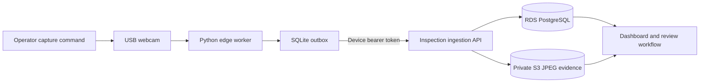

# SIGAP IoT deployment report

This report records the completed Raspberry Pi webcam-only deployment: SSH recovery, Python provisioning, edge-file transfer, backend repairs, evidence preservation, and end-to-end verification. It also documents how to reconnect and the limitations that remain. The status below reflects the last verified handover, not a new live health check.

## Deployment scope and observed hardware

The deployed station uses the connected USB webcam and manual capture commands. The buzzer, sensor, and LEDs were not connected, so physical outputs remained disabled throughout deployment.

| Component | Observed configuration |
|---|---|
| Board | Raspberry Pi 4 Model B Rev 1.5 |
| Operating system | Debian GNU/Linux 13, arm64 |
| Python | 3.13.5 |
| Camera | Logitech C270 HD Webcam |
| Camera device | `/dev/video0`, worker source `0` |
| SSH login | `dti@raspberrypi.local` |
| Last observed IPv4 | `192.168.137.74`; DHCP may change it |
| Registered station | `pi-01` |
| Bound batch | `final-ok` |
| Capture mode | `manual` |
| Inference mode | `both` |
| LED mode | `none` |
| Buzzer type | `disabled` |

The account already had video-group access, and no process owned the webcam during preflight. Hardware enumeration and a real capture confirmed camera access; no GPIO pin was toggled.

## Implemented inspection path

The Pi performs local inference and persists inspection events before uploading them. The web backend handles database and evidence storage; no database or cloud credentials were copied to the Pi.



Classification determines disposition first. In `--mode both`, the detector localizes `defect` or `unknown` results. Both ONNX models are required at runtime startup, which verifies their file hashes and tensor shapes against the manifest.

## Work completed

The deployment retained strict SSH authentication, isolated Python dependencies, and persistent inspection state. Additional backend and database actions required separate owner approval when commissioning exposed blockers.

### Restore trusted SSH access

The replacement Pi presented a different ED25519 host key from the saved hostname record. Both hostname and IPv4 advertised the same key, and the owner independently confirmed its fingerprint at the physical console:

```text
SHA256:+Qb0gmbZQiLmgcEKgl4N+BiCi0cg1nQ8fKWImSRsTuY
```

The repair replaced only the stale hostname mapping and added the verified IPv4 mapping. Unrelated records remained byte-for-byte unchanged, with no duplicate target entries. The original file was preserved at:

```text
C:/Users/Rayka/.ssh/known_hosts.before-raspberrypi-20261028T150553644875Z.bak
```

Strict native SSH checks matched the saved key. Password-authenticated checks through both endpoints returned `dti`, hostname `raspberrypi`, the expected IPv4 address, `aarch64`, and the observed Python version with exit code 0. Host checking was never disabled; private keys, hostname, and network configuration were not changed.

### Prepare the Python environment

The deployment created `/home/dti/sigap/.venv` on the Pi after confirming compatible arm64 binary wheels. Python virtual-environment support was already available. The installation used these package versions:

| Package or tool | Installed version |
|---|---|
| `onnxruntime` | `1.31.1` |
| `opencv-python-headless` | `5.0.0.93` |
| `numpy` | `2.5.4` |
| `requests` | `2.34.2` |
| `tmux` | `3.5a` |

Dependency imports and `pip check` passed. `gpiozero` was intentionally omitted because physical GPIO was disabled. No system-Python packages, forced source builds, full OS upgrade, or copied workstation virtual environment were used.

### Transfer the edge payload

Seven files were transferred through the already verified SSH/SFTP connection, preserving repository-relative paths. Every remote SHA-256 matched its local source:

| File | Purpose |
|---|---|
| [edge_inference_worker.py](../ai_models/edge_inference_worker.py) | Interactive capture, inference, alerts, outbox, and upload worker |
| [vision_runtime.py](../ai_models/vision_runtime.py) | Model integrity, preprocessing, inference, and manifest identity |
| [model-manifest.json](../ai_models/model-manifest.json) | Model filenames, hashes, shapes, and thresholds |
| [sigap-casting-yolov8-cls.onnx](../ai_models/sigap-casting-yolov8-cls.onnx) | Classifier weights |
| [sigap-casting-yolov8-detect.onnx](../ai_models/sigap-casting-yolov8-detect.onnx) | Detector weights |
| [ok.jpeg](../public/sample-frames/ok.jpeg) | Offline OK replay input |
| [defect.jpeg](../public/sample-frames/defect.jpeg) | Offline defect replay input |

The transfer excluded `.env`, `.git`, `node_modules`, SSH keys, workstation environments, and queue data. The web application itself was not installed on the Pi.

### Register operational device authentication

With owner approval, the deployment rotated only the existing `pi-01` device token and retained its `final-ok` binding. Other device registrations and batch bindings were not changed.

Authenticated device status returned HTTP 200 from the Pi. The worker used the reachable HTTPS ingestion endpoint:

```text
https://aws-sap.dsjuc7fhaopci.amplifyapp.com/api/internal/inspection-result
```

The token remained in session memory, not command-line arguments or project files. Old clients using the replaced station token will no longer authenticate. Operational ingestion did not use an internal-key fallback or enable test mode.

### Repair backend manifest packaging

The first real upload returned `409 MODEL_VERSION_MISMATCH`. Investigation found that the backend excluded the entire `ai_models` directory from its deployed server artifact, including the manifest needed for validation. The API therefore reported a stale fallback identity.

The approved fix in [next.config.ts](../next.config.ts) explicitly includes the manifest for `/api/internal/inspection-result` while excluding ONNX weights. The local production build passed, and its ingestion trace contained the manifest without model binaries.

Commit `e615976774f4e72ff5f4ec8f3308a9a42504aa71` was pushed to `aws-sap`; Amplify job 10 completed successfully. Model validation remained enabled.

### Recover exhausted database connections

Commissioning also exposed authentication failures caused by exhausted RDS connection slots, rather than an incorrect device token. Direct database diagnostics reported that remaining slots were reserved.

The owner authorized this branch-specific pool correction:

| Setting | Before | After |
|---|---|---|
| Amplify `aws-sap` database connections per process | 20 | 3 |

Amplify job 11 deployed the configuration successfully. Existing pools did not drain during the five-minute recovery check, so the owner separately authorized one controlled reboot of `sigap-postgres`.

RDS returned to availability and database queries succeeded. No schema reset, data deletion, or manual session termination was performed. The pool cap applies per process, not as a global limit across all backend instances.

### Align Python and JavaScript manifest identities

After packaging was repaired, the backend loaded the current manifest but still rejected the Pi identity. Python serialized a whole-number float as `1.0`; JavaScript serialized the same number as `1`, producing different hashes.

The approved fix in [vision_runtime.py](../ai_models/vision_runtime.py) normalizes integral floats and emits UTF-8 before hashing sorted JSON. The existing [phase gate script](../scripts/test-phase-02-03-gate.py) gained `test_manifest_identity()`, covering nested whole/fractional numbers, signed zero, and UTF-8. That regression failed before the fix and passed afterward.

The corrected Pi runtime and backend agreed on this manifest identity:

```text
d02adab2cefeeadba1da48ad5324a0f45178bf7193383f55b7f7930accd0df7d
```

A validation-only request with the corrected identity reached `MISSING_FRAME`; a stale identity still returned `MODEL_VERSION_MISMATCH`. Both probes omitted the frame, so neither could create an inspection.

### Preserve and audit the blocked inspection

The original captured event remained blocked while the conflicts were investigated. Before the owner-authorized identity correction, SQLite’s backup API preserved the original database.

The migration verified identical manifest bytes and model hashes between releases. It corrected only the unaccepted event’s serialization-derived `modelVersion`; event/item IDs, JPEG bytes, measured results, and latch state remained unchanged. A separate audit recorded preparation and application, and the same event was retried only after validation passed.

The Pi retains these artifacts:

```text
/home/dti/.local/state/sigap/edge_queue.before-canonical-20261028T173602578193Z.db
/home/dti/.local/state/sigap/edge_queue.canonical-migration-20261028T173602578193Z.jsonl
```

Both audit phases and the original backup JPEG were verified. Do not restore the obsolete blocked snapshot over the accepted operational queue.

## Deployed locations and lifecycle

The final activation switched a sibling symlink atomically while keeping queue state outside the release directory:

| Purpose | Pi location |
|---|---|
| Active release | `/home/dti/sigap/releases/20261028T173602578193Z` |
| Active symlink | `/home/dti/sigap/current` |
| Python interpreter | `/home/dti/sigap/.venv/bin/python` |
| Persistent outbox | `/home/dti/.local/state/sigap/edge_queue.db` |
| Interactive terminal | tmux session `sigap-edge` |

The worker runs with manual camera capture, both inference models, and physical outputs disabled. The final check found one active worker; resumed status reported pending 0, blocked 0, offline false, and no latched defect.

`SigapEdgeWorker.run()` reads stdin and exits on EOF. tmux preserves that interactive terminal after SSH disconnection; it does not provide reboot persistence. No systemd unit or boot-time autonomous capture was configured, and the Pi was not rebooted.

## Verification evidence

Verification exercised the real Pi and deployed API, with isolated replay before operational ingestion:

| Check | Observed result |
|---|---|
| Strict SSH trust and authenticated baseline | Verified through hostname and IPv4 |
| Runtime startup and CLI | Passed on the Pi |
| Isolated OK/defect replay | Correct sample dispositions, queued JPEGs decoded, and frame hashes matched |
| Isolated live webcam capture | Real camera frame persisted with GPIO disabled |
| Disposable smoke state | Queues removed and loopback servers stopped |
| Identity regression | Failed before correction, passed after correction |
| Deployed model gate | Correct identity recognized; stale identity rejected |
| Operational ingestion | Same preserved event accepted |
| Private evidence retrieval | Authenticated redirect and S3 download succeeded; JPEG hash matched the capture |
| Dashboard | Accepted inspection visible in Lot History |
| Terminal continuity | Real SSH PTY attach, status, and detach passed |

The accepted inspection has these recorded fields:

| Field | Value |
|---|---|
| Inspection ID | `INS-205356-0d98` |
| Event ID | `0da1d284-acfd-426a-80aa-4c0cd4746e45` |
| Item ID | `commissioning-webcam-20261028T154424Z` |
| Capture source | `pi-webcam` |
| Frame | 640 × 480 JPEG, 34,321 bytes |
| Frame SHA-256 | `916133fac3131402ee7eab5ff322db0c7b9faea178e11f9e151719a677164af4` |
| Canonical outcome | `unknown` |
| Confidence | 69.6% |
| Error code | `low_confidence` |
| Inspection status | `Pending Review` |
| Workflow status | `needs_review` |
| Batch state | `final-ok` held |

**Successful ingestion is not a QC pass.** The existing history UI also displays a misleading “Passed (OK)” badge for this unknown result. Use canonical outcome and review status; the badge was not corrected in this deployment.

These checks do not establish production accuracy, sustained throughput, or a Pi latency benchmark. The full evaluation suite was not run against production.

## Reconnect and operate

From the workstation, reconnect and attach to the existing terminal:

```sh
ssh dti@raspberrypi.local
```

Inside the SSH session:

```sh
tmux attach -t sigap-edge
```

Do not start a second worker. Inside the running station, replace `your_unique_item_id` with the actual new workpiece identifier:

```text
status
capture your_unique_item_id
```

Use the existing operator commands as needed:

| Command or key | Effect |
|---|---|
| `pause` / `resume` | Disable/enable new captures; synchronization continues |
| `ack` | Silence the buzzer, without clearing a persisted latch |
| `retry event_id` | Retry a blocked event only after its underlying conflict is resolved |
| `quit` | Safely stop the worker |
| Ctrl-b, then d | Detach tmux without stopping the station |

The device token exists only in session memory. Losing the session or rebooting requires secure token re-entry or an authorized rotation. Private evidence images require authenticated access; an anonymous browser can list the inspection but cannot retrieve its private image.

## Remaining limitations and recovery boundaries

The station is ready for manual webcam captures, subject to the recorded batch review state. The following capabilities were not deployed or validated:

- Physical LED, buzzer, or sensor behavior
- Automatic sensor-triggered inspection
- Boot-time startup or autonomous operation
- Production accuracy or sustained performance qualification
- A working compatible prior Pi release for operational rollback

The original release remains at `/home/dti/sigap/releases/20261028T151512408429Z` for audit. Its canonicalization defect makes it unsuitable for rollback against the current backend. If startup fails, stop the worker, preserve external queue/latch state and sidecars, and deploy a verified compatible release. Never delete state, falsify model identity, or bypass authorization to make a check pass.

Connecting hardware later requires wiring confirmation and separate actuation approval. Use the [project wiring guide](wiring-diagram.md); intended wiring is not proof of actual connections.

## Related implementation and operations references

The project-local skill records deployment context and reusable procedures:

- [Raspberry Pi IoT skill](../.agents/skills/raspberry-pi-iot/SKILL.md)
- [SSH recovery and read-only diagnostics](../.agents/skills/raspberry-pi-iot/references/ssh-and-diagnostics.md)
- [SIGAP edge development and deployment workflow](../.agents/skills/raspberry-pi-iot/references/sigap-edge-workflow.md)
- [Operational ingestion route](../app/api/internal/inspection-result/route.ts)

The backend packaging commit was published for Amplify deployment. At handover, the Python canonicalization fix and regression test remained local working-tree changes, with the corrected runtime already installed on the Pi. This report did not perform another deployment, capture, credential rotation, or database restart.
