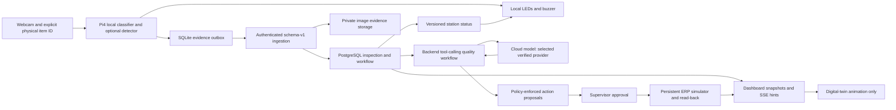

# SIGAP revised integration plan

## Context
Revise the SIGAP implementation plan for Raspberry Pi 4 (4 GB), local webcam vision and GPIO alerts, reliable backend synchronization, purposeful accessible AWS/SAP AI, and an observable business workflow. This planning deliverable changes no application behavior. On approval, publish this document as workspace `plan.md` only; the application tasks below remain a roadmap and are not authorization to implement them.
Unless prefixed with `d-day/`, `aws-sap/` or another workspace directory, application paths in the steps are relative to `d-day/`. Source line numbers are audit hints; reread current files before executing any later change.

## Audit provenance and baseline
- `plan.md` is absent from the supplied workspace: direct read failed; recursive filename search including ignored files and searches in the parent/grandparent found none; `git log --all -- '*plan.md' '*PLAN.md'` in `d-day` found no history. Do not invent a previous-plan comparison. Use the extant execution plan in `d-day/docs/SIGAP-Master-Context.md` §§12–13 and the Oct26 handoff as the recoverable baseline; retain this limitation until the original is provided.
- The handoff added by `0e0cf15` predates six substantial Oct27 commits: `fac222b` contracts/adapters, `f2920a8` ingress/auth/store, `089c258` edge corrections/queue, `2804f93` workflow/approvals/simulator, `ccfb496` UI reconciliation/geometry, and `84ea86f` QA/runtime diagnostics. Commit messages establish chronology, not correctness or passing tests.
- Guidebook §6 requires AWS and/or SAP agentic functionality; workshop rubric prioritizes innovation 25%, working demo 20%, technical AWS/SAP use 20%, fit/impact 20%, presentation 10%, Q&A 5%. Preserve a working tool-result-driven manufacturing workflow rather than add vendor services for branding.
- `aws-sap/README.md:50` explicitly says the shared Joule tenant has no SAP backend for propagated user identity; the starter kit is not evidence of S/4HANA QM/MM/PP access. `BTP_Instructions/README.md` describes AI Core and Joule access, subject to actual account verification.
- Existing `scripts/preflight.ts` writes evidence and invokes cloud AI. Do not run it in read-only planning. Provider configuration is not a successful invocation; hardware and live-service claims require execution evidence after approval for application work.

## Evidence-backed audit findings
- Preserve the schema-v1 direction in `lib/contracts.ts`: stable UUID `eventId`, exact database `batchId`, device binding version, physical `itemId`, capture timestamp, image hash/dimensions, `source-percent` boxes, explicit `ok|defect|unknown`, and separate classification/localization timings. Do not rebuild the old percentage-only handoff.
- `lib/inspection-service.ts:269–388` inserts inspection, workflow, initial trace, and counters transactionally. Validation remains incomplete: a read-only, in-memory execution of the actual `validateInspectionEvent` accepted absent probabilities/confidence, `coordinateSpace="pixels"`, contradictory outcome/probabilities, box confidence 1000, and hashed non-image bytes. These are reproduced failures, not hypothetical risks.
- `lib/sap-ai-core.ts:113–143` consumes singular `toolResult` only; `lib/quality-agent.ts:374–377` sends plural `toolResults`. A synthetic in-memory adapter probe supplied two tool observations and observed zero serialized tool messages. Bedrock supports the plural contract. Repair SAP protocol before selecting it for production reasoning.
- `app/api/inspection/analyze/route.ts:12–204` still accepts unauthenticated upload/default-generated detections, uses fabricated three-defect history, and calls ERP dispatch before persistence. It competes with the durable workflow and cannot remain an operational ingestion path. Its old reasoning function invents root-cause/history and five-stage completion.
- Existing policy is `data/quality-policy.json`: eight-minute window, three distinct defects for escalation, one for quality notification, supervisor approval for every ERP action. The handoff's ten-minute weighted E≥0.70 rule and blanket automatic dispatch are obsolete conflicting contracts.
- `quality-agent.ts:119–124` anchors a window on capture time but queries `receivedAt` without an upper bound; offline replay and future events can corrupt historical counts. Its action upsert resets existing records to `pending_approval`; hard-coded target fallback and missing tool/result validation undermine action safety.
- `scripts/workflow-worker.ts` has atomic claims and 120-second leases, but does not reclaim `verifying` dispatches, refresh leases, or bound retryable dispatch loops. `scripts/evaluate-agent.ts` constructs an unused selected adapter and treats `REVIEW_ONLY` as unconditional success. Existing QA scaffolding is useful but not proof.
- `ai_models/model-manifest.json` records classifier `[1,3,300,300]→[1,2]`, detector `[1,3,640,640]→[1,5,8400]`, and binary defect localization; this is not a four-defect-class model. The checked-in runtime evaluation manifest has only two sample images, not representative Pi or deployment-quality evidence.
- `ai_models/README.md` attributes training to Kaggle GPU and reports detector mAP50 25.86%/recall 31.58%; master context still says mAP50 55.05%. Neither documents a reproducible Pi4 benchmark. Training code even uses 5.2ms as a missing-metric default. Withdraw 6ms/>150FPS and 99.7%-production-accuracy claims pending measurements.
- Edge implementation is substantial but not hardware-verified: manual item capture, classifier-first inference, source mapping, SQLite outbox, GPIO controller and status polling exist. `edge_inference_worker.py:612–624` acknowledges every 409 and endlessly retries “permanent” failures; latch exists only in RAM, accepted JSON retains base64, passive buzzer is unimplemented, health is hard-coded true, and release polling cannot clear an existing latch. Webcam inference uses the pre-JPEG frame rather than the transmitted image.
- UI regressions are concrete: ingress emits `outcome/inspectionId/boxes`, but `sigap-global-context.tsx:183–187` tests absent `defectClass !== "OK"`, making an OK event trigger a defect animation/notification. Authoritative counters are polled, so this does not prove database overcounting. `formatters.ts:49–74` drops canonical evidence/geometry fields and returns null image URLs; `inspection-camera-panel.tsx:642–653,811–822` hard-codes 640×480 instead of source dimensions.
- The event bus is process-local (`app/api/events/route.ts:67–71`); emitting from the separate workflow process cannot notify web-process subscribers. Existing five-second snapshot reconciliation is worth retaining; active traces need explicit persisted-log polling. Timeline defaults “Reasoning verified”/“completed” despite missing evidence (`inspection-agent-trace.tsx:64–76`).
- Approval cutover is incomplete: auth/session endpoints exist, but browser mutation calls do not establish the required session/version flow. Batch page submits twice and displays success after failure (`app/dashboard/batches/page.tsx:91–129`). Batch rejection, manual dispatch creation, simulator routes and settings writes have no equivalent authorization. CSRF tokens are issued but no enforcing middleware was found in the inspected mutation paths.
- `scripts/qa-full-e2e.ts:164–204` currently checks only database readability, settings and device existence. It is not an end-to-end test; `test-phase-04-gate.ts:92–101` edits the database to simulate approval, bypassing the actual HTTP authorization boundary. Do not treat “QA” filenames or commit titles as passing acceptance evidence.

## Key changes from the recoverable previous plan
|Previous direction / handoff claim|Revised decision|
|---|---|
|Build dashboards, ingestion, model exports and agent loop from scratch|Retain implemented components; repair cross-path contradictions and failure handling before adding services.|
|GPU/IPC/Pi5 alternatives; cloud/web-upload vision|Pi4 4 GB is the operational inference target. Browser receives evidence; it does not classify products. File replay remains explicitly labeled.|
|Detector-first anti-glare gate, four defect types|Existing classifier-first binary disposition; detector is optional localization, never a veto on a classifier defect. No fine-grained defect or metallurgical-root-cause claims without labels/evidence.|
|Every frame is a product; external worker posts five steps|Explicit physical item capture, one stable event, one backend workflow. Backend owns all cloud reasoning and trace records.|
|Immediate quarantine means automatic SAP/pneumatic action|Immediate local alert and reversible application hold; thresholded proposals; supervisor-authorized, read-back-verified ERP simulation. No physical ejector or machine-stop claim.|
|Ten-minute weighted formula plus several other scoring formulas|One versioned eight-minute / three-distinct-product policy; count/threshold display, not an invented probabilistic risk score.|
|Add CAP, action-group Lambda, Knowledge Bases, A2A and assorted agents|Reuse Next.js/PostgreSQL workflow and four existing tools; direct policy/context retrieval. Add no service without a measured requirement and verified access.|
|Deadline-driven phases and cosmetic priority|Dependency and reliability gates, with AIoT ownership explicit; no conventional duration estimates or deadline-based feature cuts.|

## Recommended architecture and ownership
**AIoT/supporting-backend owner (you):** Pi runtime, model/dataset evaluation, image geometry, physical indicators, item identity, local persistence/replay, device contracts and backend reliability fixes. **Teammate/backend-web lead:** session UI, transactional approval/release endpoints, workflow runner/cloud adapters, authoritative dashboard and digital twin. **Presenter/domain owner:** labeled physical samples, policy confirmation, measured-versus-simulated business narrative. You and the teammate jointly review the shared schema/policy before parallel work; the teammate owns integration of `contracts.ts` and Prisma migrations.



### Purposeful AWS/SAP use
- **Cloud reasoning:** retain `BedrockAdapter` and its Converse tool loop as the primary configured path, using the configured model/region rather than inventing a new deployment. A nonempty AWS configuration exists in the local environment file, but permission, model availability and billing/credits are unverified. After adapter protocol repair, validate SAP AI Core as the explicit alternative with the kit's GPT-5.4 deployment and `default` resource group. Use `SIGAP_AI_PROVIDER=bedrock` when the real tool round-trip succeeds; if access is denied and SAP succeeds, explicitly select `sap-ai-core`. If neither succeeds, mark cloud reasoning unavailable and keep suspect items held; never label deterministic containment as cloud-agent success.
- **Evidence:** use private S3 via `evidence-store.ts` after write/read/hash verification. Keep PostgreSQL as the durable source of truth; a configured connection is not proof of AWS RDS hosting. Local durable evidence storage is an explicitly labeled deployment mode if S3 access is unavailable, not silent success.
- **SAP business actions:** existing `sap-client.ts` is a PostgreSQL-backed ERP simulator with HTTP endpoints and persistent state; all dispatch results are `mode="simulator"`. Keep this honest, useful business-state demonstration. AI Core model access is genuine SAP AI only after a successful request; it does not grant S/4HANA access. Do not describe these endpoints as certified OData compatibility or real supplier/production mutations.
- **Joule/BTP:** available kit guidance covers Cloud Foundry deployment and shared-tenant Joule pro-code, not proof that this team can deploy now. Do not make A2A/Joule a dependency of the working inspection loop. Do not expose mutating tools behind the kit's `NoAuthentication` destination.
- **Hosting:** keep inference off Next.js/Amplify. Run the web server and existing `scripts/workflow-worker.ts` as separately supervised long-lived processes against the same database for the demo. Amplify's current build strips ONNX and does not start the durable worker; do not assume a serverless request runs that worker.
- No live account access, cloud inference, Pi hardware, or full browser workflow was exercised during this read-only audit. Actual ONNX CPU sessions were loaded on the workstation and both binary hashes/shapes matched the manifest; that establishes artifact loadability, not Pi latency or accuracy.

## Execution steps

### P0.1 — Freeze the authoritative contracts and close competing ingestion paths
**Owners:** you + teammate; teammate integrates shared types/migration. **Dependency:** first, before parallel implementation.

1. Keep `InspectionEvent` schema version 1 and its exact existing field names. `batchId` is `Batch.id`, never the display `lotId`; `eventId` is one UUID generated before durable enqueue; `(batchId,itemId)` identifies one inspected physical product. Preserve raw classifier probabilities in `[0,1]`, display/event and box confidence in `[0,100]`, top-left source-image percentage boxes, actual JPEG dimensions, UTC capture time, `inferenceLocation="pi"` and the existing capture-source enum. `unknown` is a review outcome, not an OK synonym. No free-form porosity/crack classes from these binary models.
2. Strengthen `validateInspectionEvent` and route body limits: valid UUID and UTC timestamp; finite nonnegative timing values; required nullable probabilities/confidence; matching winning confidence and outcome thresholds; all localization/error enums; `coordinateSpace="source-percent"`; finite bounded boxes with unique IDs and `label="defect"`; bounded base64 length before decode; actual JPEG decode, width/height agreement and SHA-256. Use existing 1 MiB decoded and 1920×1080 limits. Invalid image/model outputs never create OK records. Change the four fractional timing columns on `Inspection` from `Int?` to `Float?`; retain null when unmeasured.
   - Make `Inspection.confidence Float?` with no manufactured default for new canonical records; unknown without inference stores null. Validate thresholds against the deployed manifest hash. Drain the station outbox before model/threshold deployment; a new nonduplicate event from an unknown manifest returns `409 MODEL_VERSION_MISMATCH` and remains blocked. An exact already-accepted replay is acknowledged from its stored canonical hash even after model/binding versions change, provided the same authenticated device owns it.
3. Persist `Inspection.payloadHash String?` as SHA-256 of a deterministic canonical JSON representation of every validated semantic event field (replace base64 with verified image hash; fixed field order). Use the same comparison on ordinary replay and unique-constraint races. Identical event returns existing `inspectionId/runId`, `duplicate=true`, HTTP 200; changed payload with reused ID returns `409 EVENT_CONFLICT`; different event for an existing item returns `409 ITEM_ALREADY_INSPECTED`. A successful first write returns 201 only after evidence and transaction succeed. No fallback fabricated IDs.
   - Use parameterized PostgreSQL row locking on the `Batch` row within Prisma transactions for ingress, policy proposal changes, reviews, release and approval; reread effective state after acquiring the lock. New nullable migration columns preserve old rows as `legacy-unverified`; do not backfill invented image hashes, confidence or model measurements.
4. Restrict operational ingestion to a valid enabled device token with matching device, bound batch and binding version; the Pi uses `SIGAP_DEVICE_TOKEN` only, never a bundled/default/internal supervisor key. Browser viewer/operator sessions cannot post fake Pi events. Test/admin fixture injection remains isolated to the test harness, not a production public endpoint. Recheck binding and batch state under the ingestion transaction; serialize batch mutation with approval/release to prevent a concurrent OK capture restoring stale released status over a defect hold.
5. Remove the competing `/api/inspection/analyze` implementation and its operational caller in `components/inspection/inspection-camera-panel.tsx`; convert inspection viewing to server-backed Pi evidence, with an explicit waiting state. Remove the obsolete uncorrelated `/api/internal/agent-decision` route: backend workflow execution writes its own correlated trace; no last-inspection lookup or suffix matching. Remove obsolete `deduceDefectReasoning`/deterministic fabricated reasoning and server `runOnnxInspection` path after caller cutover. Preserve `BedrockAdapter`. Exact callsite searches: `deduceDefectReasoning|runOnnxInspection|uploadInspectionFrame|/api/inspection/analyze|/api/internal/agent-decision` in `d-day/{app,components,context,lib,scripts,types,docs}`; remove `lib/aws-s3.ts` and `lib/onnx-inference.ts` only when their now-obsolete exports have no live consumers. Keep nonmutating, labeled twin demonstration controls.
6. Freeze one versioned policy from `data/quality-policy.json`: window eight minutes; distinct physical defective products, not frames; first defect permits `CREATE_QUALITY_NOTIFICATION`; three permit `HOLD_MATERIAL_LOT` and `HOLD_WORK_ORDER`; all require supervisor approval. Immediate defect containment means local red latch + application `held/quarantine`, not ERP execution or a machine stop. Unknown means application hold/review, no automatic ERP proposal. An OK product never releases an already-held lot. Replace competing E≥0.70 formulas/autonomous settings with this policy and expose a count/threshold indicator.

**Acceptance:** all five invalid events reproduced in this audit return 422 with no database/evidence mutation; ten concurrent identical submissions produce one inspection/run/counter increment and nine identical acknowledgements; a valid fractional-millisecond event persists; device from another batch is denied; legacy public inputs cannot cause inspections, model calls or ERP actions.

### P0.2 — Finish Pi inference, evidence identity and local hardware safety
**Owner:** you. **Dependencies:** P0.1 contract; independent of cloud/UI work.

1. Preserve both existing ONNX weights and classifier-first behavior. Reuse the existing `ProductionRuntime`, ROI, letterbox and NMS implementation by moving shared inference into proposed `ai_models/vision_runtime.py` and importing it from worker and evaluator; there is currently no shared production/evaluation module. Verify both model hashes, tensor shapes and class ordering at startup. Set `modelVersion` to the SHA-256 of the complete canonical manifest, covering weights, preprocessing and thresholds, not only the classifier hash.
2. Keep center-square ROI and show that inspected region in the UI; require a single supported impeller fully inside it. For webcam capture, encode once, decode those exact JPEG bytes for inference, and retain the same bytes/hash for upload. Set `capturedAt` at frame acquisition. Reject corrupt replay images; do not reinterpret arbitrary objects as supported impellers. Explicit `capture <item-id> review` records unsupported-input review, not inferred OOD capability.
3. Apply classification thresholds from the manifest (`defect≥0.80`, `ok≥0.95` initially), without another softmax. Reject nonfinite/negative/zero-sum outputs as model faults. Run detector only on defect/unknown in `both` mode; `classify` reports skipped localization. Remove misleading `detect`-only mode because it currently still classifies and must not become an alternate disposition policy.
4. Transform detector corners by undoing padding/scale, adding ROI offset, intersecting both corners with source bounds, then deriving width/height; discard empty intersections rather than fabricate minimum-width boxes. No boxes is a valid localization result and never clears a defect. Detector failure preserves classifier disposition with `localizationStatus="failed"`; classifier failure yields `unknown`, `errorCode="model_unavailable"`, no forged confidence, and fault status.
5. Drive local alert immediately after classification, before optional localization or any network operation. Measure `localAlertMs` through the actual GPIO command; null in simulated/disabled mode. Preserve BCM defaults red 17/yellow 27/green 22/buzzer 18. Use current gpiozero controller; implement its advertised passive mode with PWM tone, active mode with `Buzzer`, and bounded nonblocking chirps. GPIO initialization failure in requested physical mode is a visible station fault, never silent simulated success.
6. Make hardware states exclusive: healthy current OK = green; startup/unknown/pending = yellow; fault/offline = blinking yellow; defect latch = red with yellow offline indication. In single-red mode: solid red = latched defect, blinking red = fault/offline/review, off = no active warning (not proof of a passed product). New defect chirps twice, review once, fault three times. `ack` silences only; it never releases material or clears red. Every new defect re-arms the audible warning.
   - Indicator priority is persisted defect latch > fault/offline > unresolved review/application hold > healthy OK. Persist review attention too; a subsequent OK frame cannot turn green while an earlier suspect remains unresolved. A supported low-confidence result uses `errorCode="low_confidence"`.
7. Persist the latch, its batch/binding/case and last suspect event, acknowledged server version, and silence state in SQLite. Restore before accepting captures after restart. Extend `IngestResult` with `caseEpoch:number`, and `DeviceStatusResponse` with `batchVersion:number`. Clear only on a fresh authenticated `released` status for the same binding/batch, a newer released case/version than the acknowledged suspect, no unresolved/pending local events, and no capture in progress. Ignore stale/out-of-order/expired status; preserve local hold while offline. Do not implement unconditional clearing on any `"released"` response.
8. Use a current-limited LED circuit and buzzer driver appropriate to the module; never connect a 5V load directly to a GPIO. Confirm active versus passive module during wiring and select the existing CLI option. Physical hardware consists only of webcam, LEDs and buzzer; no pneumatic ejector, conveyor control or safety-certified interlock is implied.

**Acceptance:** camera unplug, missing/corrupt model, detector failure, wrong-object review, GPIO failure, one-red and three-LED operation, passive/active buzzer, mute/new-defect, restart and stale-release scenarios have correct observable states. Red appears with backend disconnected, stays on through restart, and clears only after the authorized fresh release path. Known 640×480 geometry round-trips to source coordinates within one source pixel before display rounding.

### P0.3 — Make offline item identity and synchronization loss-resistant
**Owner:** you; teammate owns binding/status endpoint transaction changes. **Dependencies:** P0.1 and P0.2.

1. Keep manual indexed inspection (`capture <item-id>`), one clearly labeled physical sample at a time. Do not add interval-based counting or a tracker merely to animate a conveyor. Repeated command/frame for the same batch/item does not create another event, even after process restart. Bind batch/device before capture; prohibit rebind unless paused, idle and the outbox has no unresolved entries. Snapshot binding and case under a lock for the complete capture; heartbeat cannot silently change them mid-item.
2. Keep `LocalQueueDB`, existing 500-event/250-MiB logical cap and stable event payload. Store image bytes only once locally; construct base64 for transport from the BLOB. Atomically persist the complete event and latch before reporting capture success. Include retained metadata and blocked rows in capacity accounting; enforce free-disk headroom of 100 MiB. On full/storage error stop new capture, retain previous evidence, and show fault; never evict unsent evidence.
3. Validate successful response JSON (`success`, matching event/image hash, inspection/run IDs) before acknowledgement. Only a matching 200/201 marks accepted. Never acknowledge every 409: `EVENT_CONFLICT`, `ITEM_ALREADY_INSPECTED`, and `STALE_BINDING_VERSION` retain evidence as `blocked`, display the reason and require correction/reconciliation; do not silently relabel the product or rewrite queued payload.
   - Synchronize in capture order per station/batch; do not skip an older delayed event. A blocked head pauses synchronization for that binding. Add CLI `retry <event-id>` to retry the unchanged blocked row after auth/config correction; it never marks it accepted, rewrites its product/event ID or discards evidence. Permanent schema/item conflicts remain visibly blocked rather than becoming false successful counts.
4. Keep exponential retries 1/2/4/8/16/30 seconds for network/408/429/5xx with bounded jitter and `Retry-After` support. Authentication failures pause synchronization; malformed/unauthorized/not-found/oversize/validation/conflict failures become visible blocked entries rather than endless retries. Accepted records keep only the compact item/event/ack ledger; release redundant image/base64 storage. Include blocked entries in queue depth/health. Resume transient replay with unchanged IDs/bytes after restart.
5. Derive `cameraHealthy`, `modelHealthy`, `idle`, offline status and GPIO mode from observed state, not hard-coded true flags. Extend heartbeat with `hardwareMode:"physical"|"simulated"|"fault"`, `blockedQueueDepth:number`, `lastErrorCode:string|null`; maintain the existing ten-second heartbeat and two-second polling. A stale backend does not disable local detection, but cannot authorize latch clearance. On shutdown persist state, stop and join background threads, close camera/GPIO/SQLite cleanly.

**Acceptance:** capture 20 distinct items offline, including defects; restart before upload; reconnect and obtain exactly 20 canonical inspections and the corresponding distinct-item counts. Repeat all acknowledgements, drop a successful HTTP response, inject a stale binding/conflicting event, fill the queue and deny credentials: no acknowledged loss, no repeated product count, no false green, no busy retry loop.

### P0.4 — Complete governed cloud reasoning and durable business actions
**Owners:** teammate leads workflow/adapters; you own event-time, retry/idempotency and contract review. **Dependencies:** P0.1; can run alongside P0.2–P0.3.

1. Keep `runQualityWorkflow` as the single orchestrator, invoked only through the durable worker. Do not introduce a second Python agent, LangGraph rewrite, or fire-and-forget request-handler promise. Repair `SapAiCoreAdapter.nextTurn` to serialize every plural `toolResults` entry, preserving call IDs, JSON results and error markers. Retain the existing Bedrock implementation; choose the provider explicitly under the service-access rule above.
2. Make `data/quality-policy.json` the sole behavioral policy; copy its full versioned contents into `WorkflowRun.policySnapshot` at ingress and execute from that snapshot. Stop hard-coding a different policy in ingress/prompt/settings. Count unique effective defects in the same batch and case within the closed capture-time window `[capturedAt−8 minutes, capturedAt]`; use reviewed outcomes when present, exclude `confirmed_ok` and unresolved unknowns. Preserve capture time during retries. Reject capture timestamps more than two minutes ahead of server time as reviewable clock errors; old offline events remain admissible and cannot count later products.
   - If a late event changes an already-processed newer inspection's in-window count, requeue that newest affected workflow in the same case for reevaluation; keep its run ID, append trace history and never reset authorized/rejected actions. This avoids missed escalation on out-of-order replay. Reviewed outcomes affect current decisions; original observations remain immutable.
3. Reuse the four existing tools: `get_inspection_context`, `get_quality_policy`, `get_supplier_history`, `propose_quality_action`. Return exact evidence IDs, count/window, full action thresholds/approval flags and policy version. Label the policy's supplier records as synthetic scenario data; absent supplier history is unknown, never invented. Require successful context/policy retrieval before accepting a proposal, validate tool name and arguments with `actionType` enum, and return a structured error for unknown/invalid tools. Tool execution—not prompt compliance—enforces policy and authorization.
4. For one/two distinct defects, the model may propose only QM; at three or more, propose QM/MM/PP when each target exists. Missing material/work-order identifiers block only affected actions and produce `needs_review`; delete hard-coded target fallbacks in agent, worker and simulator. Unknown outcomes use a deterministic review path with no ERP proposals. An OK outcome records “classifier passed this image”; do not assert dimension metrology, supplier integrity, zero historic defects or lot release.
5. Keep five bounded model turns. A run with missing required context, invalid repeated calls, no justified decision, provider timeout or exhausted turn limit ends `needs_review`/failed, not a fabricated `none_required` success. Capture provider/model/prompt version, usage, actual timings and concise final summary. A summary must cite retrieved facts and policy/action IDs; root causes are hypotheses requiring inspection, not model-invented facts.
6. Keep `actionKey = batchId + ":" + caseEpoch + ":" + actionType`. Persist the immutable approved action payload/target and its canonical hash. Proposal upsert must never reset queued/executing/verifying/verified/rejected actions or relink their original run; repeat calls link the existing action in the current trace. Changed payload under the same action key is a visible conflict requiring a new reviewed revision before approval, not silent mutation of an executed action.
   - Hash executable action semantics in fixed order: `{actionKey,actionType,batchId,caseEpoch,targetId}`. Context count and explanatory summary are audit evidence, not a reason to mutate/reexecute an existing business action. The worker sends the approved frozen target, never re-resolves a changed batch target at execution.
7. Use existing status/attempt/nextAttemptAt/lease fields. Add `leaseOwner:String?` to workflow and dispatch rows for fencing. Claim eligible queued/expired jobs atomically, renew the 120-second lease every 30 seconds, and require the owner on state commits. Use request timeouts (model 30s, ERP 10s) and at most five transient attempts with delays 1/2/4/8/16 seconds; permanent failures become `needs_review` for workflows or `failed` for dispatch. Reclaim `verifying` jobs to read back without reissuing the mutation. Persist external ID and `verifying` before read-back; compare action key/type/target/hash/state, not state string alone. Lost responses may resend only the same immutable idempotent action.
8. Resume a workflow attempt with persisted tool observations and completed effects, not sequence reset to 2. Allocate monotonic trace sequences under a database lock and add unique `(runId,sequence)` for canonical records after preserving legacy uncorrelated rows. Each logged tool call/result includes actual `toolCallId`, input/output, start/completion, status and measured latency. Approval and dispatch/read-back append to the original correlated run; terminal dispatch updates the run after all its required actions settle.
9. Secure QM/MM/PP simulator POST/GET routes with server-only internal authentication; a literal `x-sigap-simulator:true` is not authorization. Require a matching approved/leased `DispatchRecord` for writes and recompute/validate action hash and target. Handle concurrent action-key uniqueness through read-and-compare. Keep `mode="simulator"` on response/read-back. Remove silent network-to-in-process fallback: unavailable simulator remains an observed retry/failure; no hidden success path.

**Acceptance:** real selected-provider tool round-trip plus operational scenarios: isolated defect→QM proposal only; three distinct defects→eligible QM/MM/PP proposals; missing target→blocked affected action; unknown→review only; unknown tool→recorded error. Repeated proposals cannot reopen rejected/verified actions. Crash before/after dispatch and during verification yields one simulator record and eventual verified or explicit failed state. No cloud provider may execute hardware or approve its own proposal.

### P0.5 — Make human approval, review and release usable and atomic
**Owner:** teammate; you coordinate station-release status. **Dependencies:** P0.1/P0.4 policy and action contracts.

1. Reuse `/api/auth/login`, `/session`, `/logout` and `lib/auth.ts`; add a small login/session panel to existing dashboard layout rather than a second authentication system. Login submits `{userId,password}`; keep the HTTP-only session cookie and store returned CSRF token in memory. Enforce `x-csrf-token` against the signed session on cookie-authenticated mutations; server/device bearer calls use their distinct authorization rules. Do not hard-code credentials, grant the browser an internal key, or introduce a development supervisor bypass.
2. Require supervisor identity on batch approve/reject, inspection review, dispatch approve/reject and settings writes; manual dispatch creation may be operator/supervisor but only creates a policy-validated pending proposal, never executes. Read-only roles cannot mutate. Remove synthetic fallback success messages and double mutation calls in batch/dispatch UI; await one request and render 401/403/409 errors accurately.
3. Require `{expectedBatchVersion,reason}` for batch release/reject, `{expectedRevision,expectedBatchVersion,reason}` for dispatch approve/reject, and `{reviewOutcome,reason,expectedBatchVersion}` for inspection review. Return these versions in authoritative API views. Reject empty review/approval reasons. Perform read-check-update and relevant trace writes atomically with the same per-batch lock used by ingress; stale version/case returns 409 and refreshes UI.
4. Review preserves original model outcome/evidence and adds reviewer/time/reason; it updates effective defect aggregates, increments batch version and invalidates unexecuted stale proposals transactionally. Unknown confirmed-defect requeues its existing workflow with reviewed evidence; confirmed-OK cannot auto-release a lot. Recompute eligibility before approval/dispatch so a withdrawn defect cannot authorize a stale action.
5. Release and action approval are separate controls: “Approve ERP action” queues only that action; “Release application lot” requires every suspect in the current case to be `confirmed_ok`, no active verified ERP hold, no queued/executing/verifying action and no active workflow for that case. Cancel pending proposals and finish obsolete review runs in the release transaction; increment batch version/case once. Repeated old release returns version conflict, not another case increment. A verified ERP hold blocks local release with `ERP_HOLD_ACTIVE`; this plan does not invent an ERP-unhold operation.
   - Application release additionally requires a ≤30-second fresh heartbeat from the bound station showing paused, idle, pending queue zero and blocked queue zero. Reject stale/offline release rather than changing the case underneath unsynchronized products. Rebind requires no unresolved physical/application latch; moving to another batch is not an alert reset.
6. Rejection preserves containment, cancels unsent actions and records the decision; it never reports that SAP executed. Rebinding uses existing device binding endpoint only while paused/drained and publishes a new binding/state version. Display independent station mute/alert status, application lot status, ERP action status and twin animation status.

**Acceptance:** logged-out→401; viewer/operator approval→403; supervisor with stale version→409; valid approval→queued without premature success; rejected action never executes. Confirmed-OK review + clean release clears the physical latch through P0.2; an active verified ERP hold or unreviewed suspect blocks it. Concurrent defect ingestion cannot race a successful unsafe release.

### P0.6 — Reconcile truthful evidence, trace timeline and digital twin
**Owner:** teammate; you supply geometry fixtures and station telemetry. **Dependencies:** P0.1 views; integrates P0.2–P0.5.

1. Make `InspectionView` the canonical inspection JSON for APIs and `inspection:created`; add `imageWidth:number`, `imageHeight:number` and `imageSha256:string`. Use `inspectionId`/`eventId` consistently rather than fabricated client IDs. Update `formatInspectionRecord` and all consumers found by `InspectionRecord|InspectionView|formatInspectionRecord|onInspectionCreated|applyInspectionSnapshot` across `lib`, `types`, `context`, `hooks`, `components`, `app`. Preserve display labels as presentation fields, never overload database IDs with lot labels. Include nullable confidence, all timing/localization fields, boxes, review and run/case correlation. No missing-field defaults implying pass/defect/verified.
2. Produce `imageUrl="/api/inspections/"+inspectionId+"/image"` when stored evidence exists. Persist `Inspection.evidenceStore:"local"|"s3"` (Prisma String?) at ingest; serve according to the record rather than inconsistent environment inference. Reuse authenticated image route and `getEvidence`/S3 signed URLs; remove the nonexistent local signed-URL route fallback. Hash-check fetched evidence in validation. If image/storage unavailable, show unavailable without an unrelated sample image.
3. Render the image and boxes in one SVG with `viewBox="0 0 imageWidth imageHeight"`; scale x/width by imageWidth/100 and y/height by imageHeight/100. Apply the same aspect-ratio transform to both; no object-cover crop or mirrored viewport for source evidence. Show center ROI and localized/skipped/failed status; absent boxes do not imply no defect. Both history and current inspection must use the same stored frame, not a new live frame.
4. Consume outcome explicitly: OK→pass animation, defect→defect animation, unknown→review/scan state. Deduplicate animations/notifications by `eventId`; replace aggregate values from server snapshots, never increment counts from replays. Separate unknown counts from passed units. Remove fabricated escalation values 0.88/0.45/0.05 and fallback suppliers/tickets/counters from operational views; absent values display unknown.
5. Keep process-local SSE as a best-effort refresh hint, not the source of truth. Reuse `/api/agent/logs?inspectionId=...` and snapshot APIs for two-second polling while viewing an active run; existing five-second global refresh handles inactive views. On SSE open/reconnect and page visibility restore, fetch authoritative snapshots. This deliberately avoids a new Redis/broker dependency and works with the separately supervised worker. Acceptance is dashboard reconciliation within five seconds, not the handoff's unsupported <50ms broadcast claim.
   - Change `app/api/agent/logs/route.ts` to return persisted `runId,sequence,toolCallId,stage,kind,status,startedAt,completedAt,input,output,decision,latencyMs` with ISO timestamps, sorted by sequence for a selected run. Add optional `runId` and `afterSequence` filters, bounded page size 200, and fetch successive pages until caught up. Remove canonical-run fallback to legacy JSON traces; legacy snapshots may be displayed only as unverified, not executed results.
6. Five stages group actual persisted execution: DETECT = real Pi result; MEMORY = actual context/history retrieval; FORMULA = actual policy/count; DECISION = governed proposal/review with concise summary; DISPATCH = pending approval, rejected, executing, verifying or verified with read-back evidence. Unneeded stages are explicitly skipped (OK and unknown branches), not manufactured completed checks. Show tool calls/results and measured durations on expansion; never request/display hidden chain-of-thought. Merge by run/sequence, reset on inspection change, and fetch missing records instead of replacing the timeline with one arriving step.
7. Remove hard-coded `6.0ms`, `99.72%`, fake inventory, and “Autonomous SAP” badges from operational twin/inspection surfaces. Show measured inference, heartbeat age, physical/simulated/fault hardware mode, selected real AI provider, and `ERP simulator`. Keep manual animation controls visibly `Simulation — no hardware or ERP action`; event-driven animations remain digital representations, never claims of physical sorting. Hide unsupported model/autonomy/hardware controls or make them read-only reflections of effective policy/manifest.

**Acceptance:** one OK event never raises a defect notification; two distinct events remain separate; refresh/reconnect restores exactly the same counters and trace. Synthetic non-square 1280×720, 640×480 and portrait fixtures align image/boxes at desktop and narrow widths. Login→evidence→review→approval is operable in the browser; API errors show errors. The trace reflects pending/rejected/read-back failure honestly across worker/web processes.

### P1.1 — Measure AI quality and Pi capacity before changing models
**Owner:** you; presenter/domain owner labels samples; teammate reviews agent evaluations. **Dependencies:** baseline capture can begin immediately; acceptance uses P0.2 shared runtime and P0.4 workflow.

1. Keep existing weights as baseline. Extend `ai_models/evaluation/manifest.json` beyond two smoke images with sample ID/hash, product/group ID, source, capture conditions, split, supported/unsupported label, binary ground truth and annotated source-pixel boxes. Split by physical product/source sequence, not adjacent frames; calibration/training and held-out evaluation must not share instances. Preserve dataset origin/license and model/training run hashes. Training scripts do not prove published accuracy or export performance.
2. Use at least 50 independent OK and 50 independent defective held-out supported-product images, plus 20 challenge captures (glare, blur, partial ROI, empty station, unsupported item). Include actual Pi webcam/fixture/light conditions; report public-dataset and webcam-domain results separately. Annotate at least 30 defective held-out images for localization. Manual wrong-object review measures the review workflow, not automatic OOD recognition.
3. Make `evaluate_runtime.py` use shared production JPEG/preprocessing/gating, enforce `requiresLocalization`/confidence requirements, fail missing/undecodable samples and exit nonzero when gates fail. Report per-sample results, three-way confusion matrix, defect→OK escape, OK→defect false alarms, supported unknown rate, class precision/recall, box precision at IoU≥0.5, localization coverage, sample counts and 95% confidence intervals. Do not compute accuracy only on accepted predictions.
4. Initial demonstration gates—targets, not measurements: supported defect→OK escape ≤5%; OK→defect false alarms ≤10%; supported unknown rate ≤15%; ≥80% of displayed boxes match truth at IoU≥0.5. Report localization coverage separately; missing boxes are visibly “not localized,” never synthesized. A box demonstration uses a held-out supported sample with measured localization without hiding aggregate coverage.
5. Diagnose in order: evidence/crop/class mapping and preprocessing parity; capture fixture/lighting/blur; dataset/label quality; threshold calibration; only then fine-tune the existing failing classifier/detector on new labeled training data. Calibration selects the lowest supported unknown rate among settings satisfying escape/false-alarm gates; freeze before final test. Low box recall does not justify replacing a good classifier. Quantization/model architecture changes require measured resource failure first. Reject an optimized candidate if defect recall drops >1 percentage point or false-alarm gates fail; retain float32 and report the slower indexed-inspection cadence.
   - Calibration grid: defect threshold `{0.70,0.75,0.80,0.85,0.90}`, OK threshold `{0.90,0.95,0.98,0.99}`; choose among gate-passing pairs by lowest unknown rate, then higher OK threshold, then lower defect threshold. Detector score grid `{0.35,0.45,0.55,0.65}` keeps current NMS thresholds; select highest coverage meeting box-precision gate. Preserve current architecture if no candidate passes and collect/fine-tune on the failing conditions rather than invent an unmeasured replacement.
6. On Pi4 4 GB/64-bit OS record CPU/OS/ORT version, power/cooling, model/manifest hashes, camera resolution, threads, temperature, throttling and RSS. Compare one/two/four ORT threads; select the lowest count meeting gates. Run 20 warmups, then 200 measured mixed OK/defect/unknown item runs and a 30-minute capture thermal soak. Separate cold load, capture, JPEG, preprocessing/classification, localization/postprocessing, actual GPIO-command latency, durable enqueue and synchronization. Cloud time is not local alert latency; model FPS is not end-to-end throughput.
7. Pi gates: p95 classifier ≤500ms, capture-to-local-alert ≤1000ms, full optional localization ≤2000ms; process RSS ≤1 GiB, available RAM ≥512 MiB; no OOM, sustained thermal throttling or lost capture at one explicit item per three seconds. If localization alone misses, retain immediate classifier alert and local asynchronous localization of the same immutable event before enqueue. Never cloud-offload vision. If classification remains slow after thread/preprocessing correction, compare ONNX quantization against the same quality set before replacing a model. A missed gate remains a reported failure, not a claimed measurement.
8. Repair `scripts/evaluate-agent.ts`: `--provider` must select the actual workflow adapter, not an unused variable; assert exact permitted/blocked actions, approval boundaries, factual tool results and terminal states. Replace unconditional `REVIEW_ONLY` pass. Missing-target fixtures expect blocked actions, not invented IDs. Evaluate the eight existing scenarios plus tool timeout, malformed arguments, two-tool response, provider denial and review correction five times per configured provider. Gates: 100% authorization/policy safety; ≥95% correct action/review outcomes; 100% summaries supported by facts; zero invented targets/history; measured cloud decision p95≤30s excluding human wait. Report latency and correctness separately.

**Improvement ownership:** model/dataset/preprocessing failures belong to you; missing observations/schema/grounding/retry failures belong to supporting backend; change prompts only after tools return correct facts. Keep policy outside the model. No automatic retraining or threshold mutation from supervisor feedback.

### P1.2 — Exercise the integrated station and deliver defensible evidence
**Owners:** you run Pi/failure scenarios; teammate runs browser/business actions; presenter explains evidence. **Dependencies:** all P0 steps and P1.1.

1. Repair existing focused QA entry points instead of adding a broad suite. `test-phase-01-gate.ts` uses real bounded JPEG fixtures and HTTP schema/auth plus transaction/race checks. `test-phase-04-gate.ts` logs in and approves through actual routes, not direct database updates. `qa-full-e2e.ts --critical` exercises ingestion→workflow→approval→dispatch/read-back. Replace incidental-default assertions with behavior assertions.
2. All mutating QA/evaluation/seed entry points require `SIGAP_TEST_MODE=1` and an explicit isolated database identity matching the running server's sanitized runtime identity; stop before writes on mismatch. Use unique test IDs and `dataOrigin="synthetic"`. Demo seed requires an empty dedicated demo database; never reset counters while retaining inspections. Load environment explicitly and never print tokens, connection strings or raw provider error bodies.
3. Record redacted evidence: commit/model/manifest/policy/provider versions, stage timing distributions, stable event/inspection/run/action IDs, physical/simulation mode, queue before/after and exact read-back. Rehearse three consecutive complete runs with identical business results and no extra counts/actions. Record the actual station workflow as backup.

### Coordination checkpoints
- P0.1 freezes all wire/schema additions, including the later P0.2/P0.3/P0.6 fields, before the Pi/web owners branch. Land a buildable shared contract/migration with caller updates, not partial types that break the other runtime.
- After P0.1, you own P0.2/P0.3 and shared-runtime benchmarks; the teammate owns P0.4/P0.5/P0.6. Integrate against canonical good/defect/unknown JPEG and action/trace fixtures, with computed hashes and actual dimensions.
- Checkpoint: Pi event/backend acknowledgement agree on event/item/batch/binding/case; backend/browser agree on run/sequence; dispatch/simulator agree on action key/hash/target; physical release uses versioned status. No owner invents a fallback for another owner's missing data.

## Focused validation and execution commands
Commands below apply to later application implementation, **not** publication of this planning document. No full suite, database mutation, live provider call or browser workflow ran during planning. Read-only probes loaded actual ONNX sessions and executed the actual validator/SAP serializer in memory.

### Prerequisites
- Working directory: `d-day/`. Node.js 20.6+, existing dependencies, generated Prisma client matching the reviewed migration, dedicated PostgreSQL test database. Apply migrations only to that isolated database for QA; preserve demo/user records.
- Set `DATABASE_URL`, `SIGAP_TEST_MODE=1`, `SIGAP_BASE_URL`, `SIGAP_SESSION_SECRET`, scrypt-backed `SIGAP_USERS_JSON` entries for viewer/operator/supervisor, unique `SIGAP_DEVICE_TOKEN`, server-only `INTERNAL_API_KEY`, explicit `SIGAP_AI_PROVIDER` and `SIGAP_EVIDENCE_STORE`. S3 requires authorized bucket/region/credentials or workload role; local mode requires a durable directory shared by web/worker. Keep secrets in ignored configuration/environment, not command arguments or this plan.
  Add `SIGAP_TEST_DB_IDENTITY_HASH` containing the independently confirmed SHA-256 of test database host/name; mutating scripts compare it with both their parsed connection identity and `/api/internal/runtime-status`. This is an identity guard, not a secret or substitute for a dedicated database.
- SAP alternative: protected `SIGAP_SAP_AI_CORE_SERVICE_KEY_FILE`, `SIGAP_SAP_DEPLOYMENT_ID=d1a82575de60e02a`, `SIGAP_SAP_RESOURCE_GROUP=default`. Verify deployment with a real tool round-trip. AWS permissions require actual model/evidence operations; Kiro/Builder ID is not cloud API access.
- Pi: 64-bit Raspberry Pi OS, compatible `onnxruntime`, `opencv-python-headless`, `numpy`, `requests`, `gpiozero`, safely wired webcam/indicators, verified models, writable SQLite and valid device binding. Hardware gates require the actual Pi.

### Runbook
After implementation/migration, start Next.js against the empty isolated database in one terminal:

```text
node --env-file=.env node_modules/next/dist/bin/next dev
```

With that server available for identity checks, provision once from another terminal:

```text
node --env-file=.env --import tsx scripts/qa-full-e2e.ts --seed-demo
```

Leave the autonomous worker stopped for the focused phase gates and provider evaluation: those scripts drive their own workflow/dispatch steps. Start it in a separate terminal for `--critical` end-to-end and browser/Pi verification:

```text
node --env-file=.env --import tsx scripts/workflow-worker.ts
```

Run repaired gates in isolation:

```text
node --env-file=.env --import tsx scripts/preflight.ts
node --env-file=.env --import tsx scripts/test-phase-01-gate.ts
node --env-file=.env --import tsx scripts/test-phase-04-gate.ts
node --env-file=.env --import tsx scripts/evaluate-agent.ts --provider bedrock
node --env-file=.env --import tsx scripts/qa-full-e2e.ts --critical
```

For configured SAP, use `node --env-file=.env --import tsx scripts/evaluate-agent.ts --provider sap-ai-core`. Unconfigured providers are unverified, not passed. Strengthen preflight to verify two tool observations in a subsequent model decision, not merely any response; keep its evidence write/read/hash probe.

On Pi, with token exported securely and reachable API:

```text
python ai_models/evaluate_runtime.py --manifest ai_models/evaluation/manifest.json --benchmark --samples 200 --threads 2
python ai_models/edge_inference_worker.py --source 0 --capture-mode manual --device-id pi-01 --batch-id final-ok --api-url https://<approved-api-host>/api/internal/inspection-result --queue-path data/edge_queue.db --mode both --led-mode three --buzzer-type active
```

Repeat evaluator with `--threads 1` and `--threads 4`; implement the specified 20 warmups/resource reporting first. Use `--led-mode red` for one LED and the correct active/passive buzzer type. Existing interactions: `capture OK-001`, `capture DEF-001`, `capture UNSUPPORTED-001 review`, `pause`, `resume`, `ack`, `quit`. For labeled Pi replay use `--source-image public/sample-frames/defect.jpeg --capture-mode replay`; new IDs represent distinct recorded products, not repetitions. Replay proves local inference/integration, not physical camera classification.

### Critical workflow and failure checks
|Check|Input / interruption|Required observable result|
|---|---|---|
|Identity/integrity|Concurrent duplicates; changed outcome under same ID; repeated item; wrong binding; non-JPEG frame|One valid count/run; stable ACK or explicit conflict; no corrupted evidence or unsafe state.|
|Offline durability|Disconnect; capture 20 products; restart; reconnect; lose ACK|Same 20 IDs/image hashes; no duplicate count/action; red independent of WAN.|
|Local containment|Defect then OK; mute then new defect; restart; stale release|Latch persists until authorized fresh release; new defect re-arms buzzer; no false healthy status.|
|Event-time policy|Three in-window defects versus one outside; delayed replay; repeated item|Same-case capture-time distinct counts; no future leakage or frame inflation.|
|Approval boundary|Anonymous/operator approval; stale version; concurrent reject/approve or capture/release|401/403/409, no forbidden simulator mutation; successful transition once.|
|Provider/tools|SAP multi-tool response; bad tool; denied provider; missing target|Complete observations; explicit failure/review; no invented success.|
|Dispatch recovery|Crash after mutation/before read-back; timeout; repeated proposal|One immutable simulator record; verification resumes; rejected/verified never reopen.|
|Evidence/browser|Non-square fixture; unknown; SSE reconnect; inspection switch; expired login|Aligned boxes; correct counts; no stale trace or false pass/defect; honest errors.|
|Physical proof|Observe GPIO offline, then reconnect|Hardware and durable queue agree; twin motion cannot actuate hardware.|

Use the actual dashboard to sign in, select Pi evidence, expand tool details, review a suspect, approve/reject an action and inspect read-back. Capture screenshots with the same correlation IDs. Route-only tests do not satisfy UI acceptance.

## Final demo scenario
**Story:** A small casting line keeps detecting and containing suspect products offline; a grounded agent converts observations into accountable business actions.

1. Show Pi4/webcam/LEDs/buzzer and model/manifest version. Labels: **physical Pi vision**, **verified cloud AI provider**, **ERP simulator**, **digital-twin animation**. One supported OK impeller yields one count, green, the same stored frame, no defect alert and no LLM charge.
2. Before the main defect lot, demonstrate review recovery on a separate supported sample/lot using explicit `capture REVIEW-001 review`: yellow/review is an operator-requested review, not a claimed classifier defect. Supervisor inspects the stored image, confirms OK and releases the case; fresh versioned status clears review attention. Then pause/drain and bind the station to the prepared defect lot. Capture a genuine defective supported sample: red/chirp before cloud response, stored evidence and any genuine box appear. Show actual context/policy retrieval; one defect proposes QM pending approval, not a machine stop.
3. Disconnect backend connectivity and inspect two more distinct defective samples. Local alerts work, outbox grows; repeating an item ID is rejected. Restart the worker once to show persistent alert and queue.
4. Reconnect: exactly three defects satisfy the eight-minute policy. Inspect factual summaries, tool outputs, policy and correlation IDs. Approve QM/material hold; reject work-order hold. Show simulator `OPEN`/`QUALITY_HOLD` read-back and zero executed work-order hold. Replay/duplicate approval creates nothing extra.
5. Attempt local release: verified ERP hold blocks it and the physical red latch stays on. Explain that application release is not ERP reversal or a safety interlock. Do not rebind away from this unresolved latched case or relabel the true defect as OK for showmanship; the earlier separate review case already demonstrated authorized recovery.
6. Show measured Pi p50/p95, accuracy denominators/escape/false alarms/unknowns, replay counts and detection-to-proposal/approval-to-verified timings. Time a controlled manual escalation task against the same workflow; label this as a trial baseline. Factory savings remain projections with volume/labor assumptions. No unsupported OEE, >150 FPS or zero-escape claims.

Network outage fallback: show actual offline behavior plus the explicitly labeled recording of a successful cloud run. If real impellers are unavailable, label printed props/images/replay honestly; they do not satisfy physical-workpiece accuracy gates. One-red-LED hardware uses the specified patterns without changing backend contracts.

## Assumptions and contingencies
- Original `plan.md` was unrecoverable; this replacement uses the extant master-context execution plan and actual code/history, not an invented line-by-line comparison. If the original appears, reconcile any additional user requirements before application implementation.
- Conservative policy: all ERP actions need supervisor approval; local/application containment is immediate and reversible; capture identifies one item. Any autonomy change requires a revised policy and tests, not a bypassing UI toggle.
- Repository contents do not establish physical Pi availability, buzzer electrical type or real casting samples. Defaults/alternate modes are specified; no Pi means hardware gates remain unverified, never substituted with workstation measurements.
- AWS configuration and SAP deployments establish candidates, not access proof. Provider selection/failure behavior is specified; no real S/4HANA entitlement or new service is assumed.
- Approval publishes this document to `plan.md` only. Preserve application files and the read-only organizer `aws-sap/` kit; application execution requires a separate user instruction.
